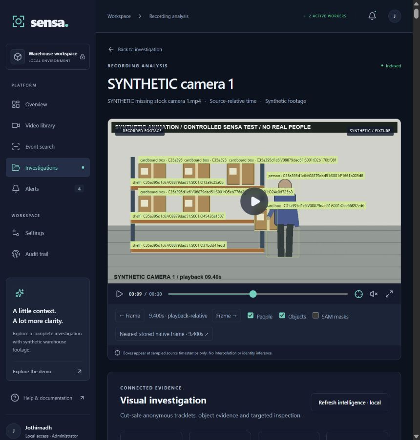
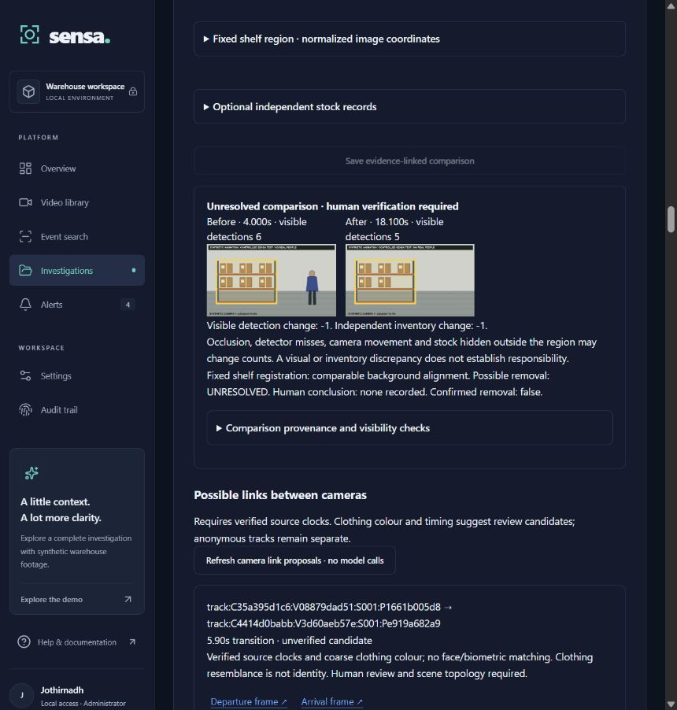
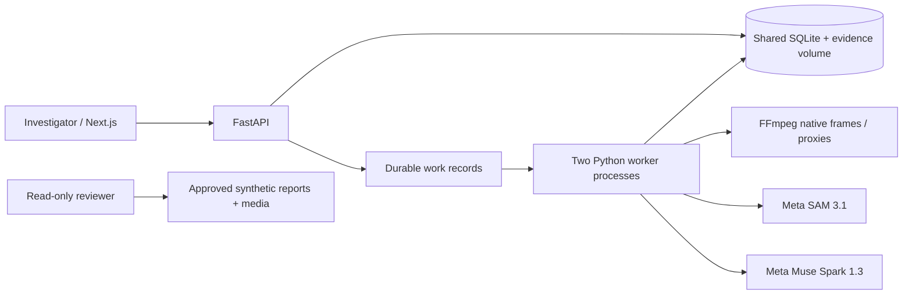

# SENSA — Cameras That Understand

**Cameras that understand. Investigations that find evidence.**

[Live dashboard](https://sensa.p-jothirnadh1.workers.dev/) · [GitHub source](https://github.com/JOTHIRNADHREDDY/SENSA) · [Demo video](demo/walkthrough.mp4) · [Investigation summary](reports/SENSA_Hackathon_Investigation_Summary_FINAL.pdf) · [Technical appendix](reports/SENSA_Hackathon_Technical_Evidence_Appendix_FINAL.pdf)

SENSA turns authorized CCTV recordings into searchable investigations. Describe what is missing or what to find, choose the recordings, and discover candidate people, objects, interactions, and time intervals without knowing the incident timestamp. Open each finding’s original footage, source-relative timestamp, and evidence before deciding what it supports.

The controlled demonstration is **synthetic**. Its accepted shelf comparison is **UNRESOLVED**. Visible detections change from six to five, with a separate synthetic renderer reference. Physical removal, real identity, and responsibility remain unverified.



## Describe → Discover → Reconstruct → Verify

An investigator looking for missing warehouse stock may have hours of footage and no incident time. SENSA searches indexed evidence or runs explicitly authorized bounded analysis, then organizes related samples into anonymous tracklets, event episodes, and an evidence graph. A reviewer can search the timeline, replay candidate intervals, compare shelf views, and record a human decision.

- Register and upload recordings, preserving original bytes and SHA-256.
- Use SAM 3.1 for visual localization and masks and Muse Spark 1.3 for scene interpretation.
- Track anonymous person and object associations within continuous segments.
- Aggregate candidate interactions and re-inspect uncertain intervals within authorized limits.
- Preserve frame, model run, artifact, source-clock, and coverage provenance.
- Export versioned PDF and portable JSON evidence with uncertainty and human review.



## Architecture



Next.js, React, and TypeScript provide the investigation UI. FastAPI, Pydantic, SQLAlchemy, Pillow, and FFmpeg manage evidence and analysis. Numbered migrations v1–v4 and durable lease-based workers support local persistence. [Architecture](docs/ARCHITECTURE.md) · [API](docs/API.md) · [Model integrations](docs/AI_MODELS.md)

## Install and run

Use Python 3.12 and Node.js 22.18 or newer. Install from the pinned Python lockfile and npm lockfile. FFmpeg comes with `imageio-ffmpeg`.

```powershell
python -m venv .venv
.venv/Scripts/python.exe -m pip install -r backend/requirements-lock.txt
npm --prefix frontend ci
Copy-Item .env.example .env
npm --prefix frontend run build
& scripts/start.ps1 -Production -Background -Workers 2
& scripts/preflight.ps1 -ExpectedWorkers 2
```

Open [the local application](http://127.0.0.1:3001) and create your first administrator. For a development frontend, omit `-Production -Background`. Stop launcher-owned services with `scripts/stop.ps1`. On macOS or Linux, use the manual backend, frontend, and worker commands in [setup](docs/SETUP.md).

The launcher loads nonempty values from private `.env`. Local synthetic processing needs no API key. Set `MODEL_API_KEY` only for backend/workers and explicitly authorize external processing in the application. `SENSA_AUTH_MODE=signin` is the default. Optional `local` mode permits only access on the same computer. Model IDs remain `sam-3.1` and `muse-spark-1.3`. [Environment and setup details](docs/SETUP.md)

## Try the demo

The [reviewer and real-video guide](demo/README.md) covers offline evidence review, the parking-lot smoke test, and access conditions for UFPR and VIRAT.

The 316.71-second parking-lot recording passed ingestion, source range retrieval, timestamp extraction, frame integrity and report export. Live SAM 3.1 and Muse Spark 1.3 inspection covered sampled frames from 0–8 seconds. [Real-video QA](docs/REAL_VIDEO_QA.md)

For a fresh interactive workspace, choose **Explore the demo** to generate four synthetic recordings through the actual media pipeline. Fixture annotations apply only to generated, hash-matched sources. To inspect the approved missing-stock case with its saved v8 evidence and no model access, run the read-only reviewer.

```sh
docker compose --profile reviewer up -d --build
```

Open [the local reviewer](http://127.0.0.1:3002), search `possible_carry`, select an episode, and replay the original synthetic source. The four native frames and both PDFs are available for inspection. The reviewer has no database, model credential, or mutation API. The [public Worker](https://sensa.p-jothirnadh1.workers.dev/) serves the full investigator dashboard with sign-in; its API reaches the backend on this computer through a private Cloudflare Tunnel. The computer and Tunnel must remain online. [Deployment, HTTPS, backup and recovery](docs/DEPLOYMENT.md)

## Evidence release

The approved v8 report is `45c9e337-8fef-4e49-9588-ccb8561c07c0`, with **442 detection records**, **13 episodes**, and **94 distinct episode support observations**. Both PDFs embed four native images matching the JSON manifest. The summary has five pages and the appendix has 48.

- [Portable v8 JSON](reports/SENSA_Hackathon_Report_FINAL.json)
- [Published report SHA-256 values](reports/SHA256SUMS.txt)
- [Repository audit and verification](docs/RELEASE.md)

This saved run used existing indexed evidence and made zero new provider requests. Earlier successful Meta runs remain in the evidence. AI interpretations require human verification. Fixture clocks, incomplete coverage and unresolved findings remain explicit.

## Test

```powershell
.venv/Scripts/python.exe -m pytest -q
.venv/Scripts/python.exe -m ruff check backend scripts/validate_release.py scripts/publication_check.py scripts/check_reviewer.py
.venv/Scripts/python.exe -m ruff format --check backend scripts/validate_release.py scripts/publication_check.py scripts/check_reviewer.py
.venv/Scripts/python.exe -m pip install -r backend/requirements-release.txt
.venv/Scripts/python.exe scripts/validate_release.py
.venv/Scripts/python.exe scripts/publication_check.py
npm --prefix frontend test
npm --prefix frontend run format:check
npm --prefix frontend run build
npm --prefix frontend run typecheck
npm --prefix frontend run lint
```

The final local run passed 136 backend and 6 frontend tests. GitHub Actions runs the suites, evidence checks, Docker builds, a shared SQLite stack, an ingestion smoke test and a Chrome reviewer test. The TypeScript lint command checks unused code and unreachable statements. [Release verification](docs/RELEASE.md)

## Limitations, privacy, and rights

Synthetic tests verify workflow and provenance. Real-world theft detection accuracy, long-form camera coverage, and physical multi-camera synchronization remain unvalidated. Anonymous tracks do not identify a real person or establish guilt. [Limitations](docs/LIMITATIONS.md)

The repository includes approved synthetic sources and portable evidence. Private SQLite databases, API keys, original private footage, raw model responses, logs and build caches stay outside Git. [Security and privacy](docs/SECURITY_AND_PRIVACY.md)

No project-wide open-source license has been authorized. Source is published for review without an additional reuse license. Existing generated-fixture provenance describes the synthetic videos as CC0-1.0. Dependency terms and Meta service obligations apply separately. See [dependency attribution](docs/ATTRIBUTION.md) and [release notes](docs/RELEASE.md).
